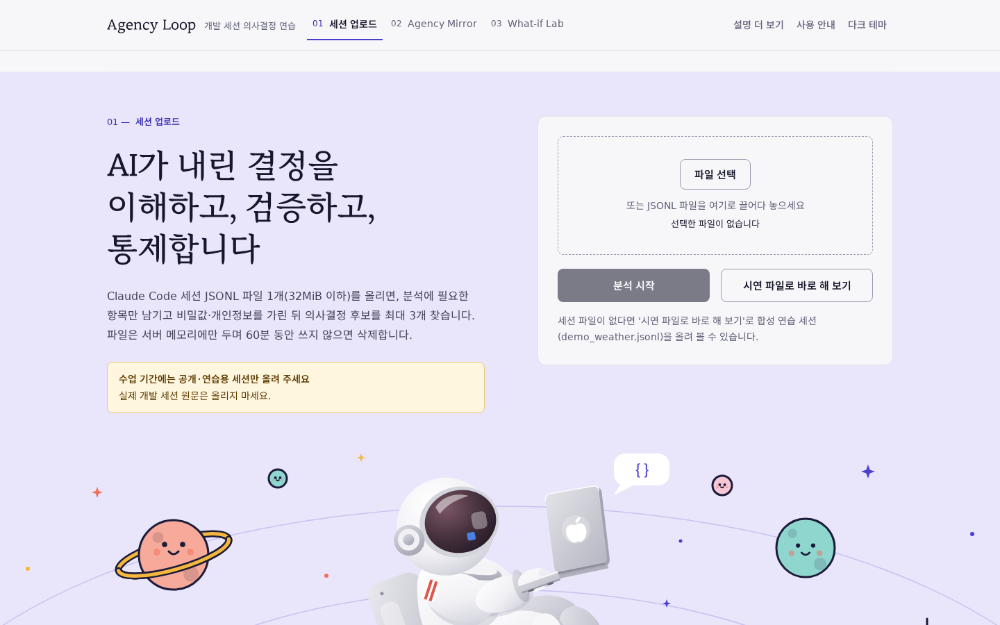
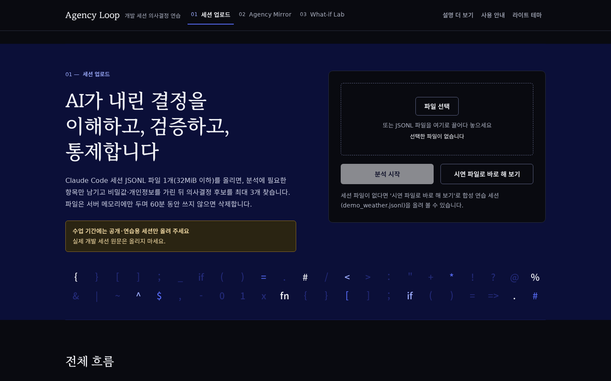
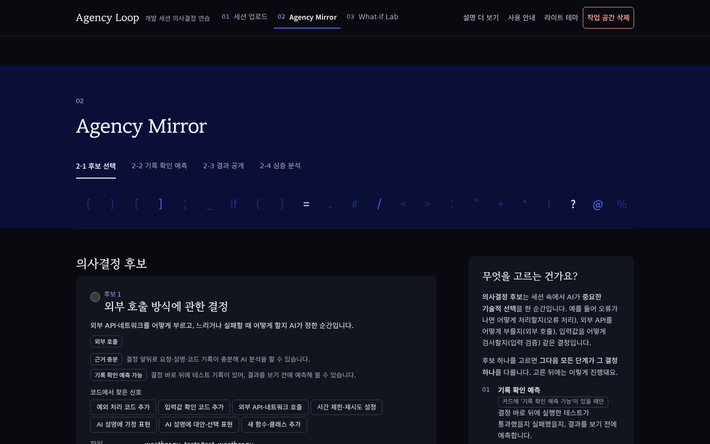
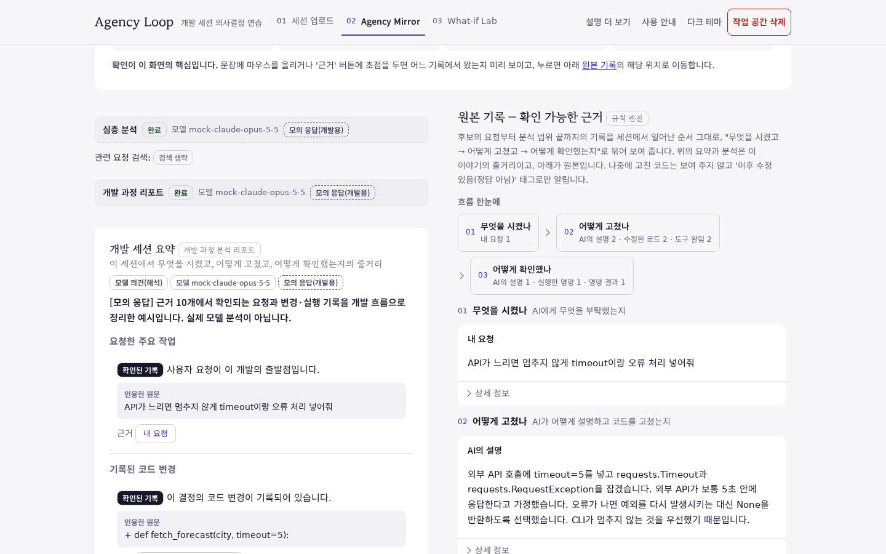
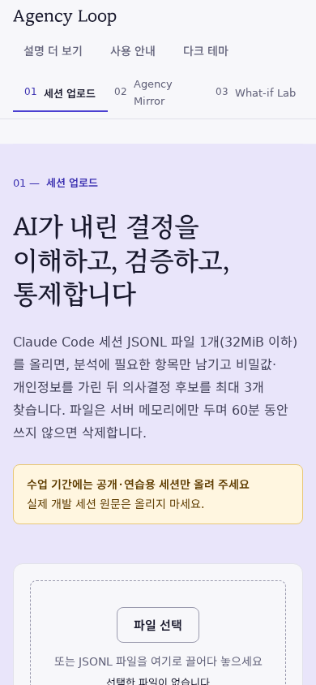

<div align="center">

# Agency Loop

**AI가 내린 결정을 이해하고, 검증하고, 통제하는 연습**

Claude Code 개발 세션(JSONL)에서 AI의 중요한 기술적 결정을 찾아,
개발자가 그 결정을 원본 기록으로 되짚어 보도록 돕는 웹 서비스 MVP입니다.


-F7DF1E?logo=javascript&logoColor=black)




</div>

## 목차

- [소개](#소개)
- [화면](#화면)
- [주요 기능](#주요-기능)
- [기술 스택](#기술-스택)
- [빠른 시작](#빠른-시작)
- [설정](#설정)
- [테스트](#테스트)
- [프로젝트 구조](#프로젝트-구조)
- [보안과 한계](#보안과-한계)
- [문서](#문서)

## 소개

AI 코딩 에이전트와 함께 개발하면 코드는 빨리 나오지만, **왜 그렇게 짰는지**와 **정말 맞는지**는 놓치기 쉽습니다. Agency Loop는 세션 기록 하나를 올리면 세 단계로 그 공백을 메우는 연습을 하게 합니다.

| 단계 | 하는 일 |
|---|---|
| **01 세션 업로드** | JSONL 파일 1개(32MiB 이하)를 올리면 비밀값·개인정보를 가리고 의사결정 후보를 최대 3개 찾습니다 |
| **02 Agency Mirror** | 후보 하나를 골라 테스트 결과를 먼저 예측하고, 근거가 붙은 분석을 원본 기록과 나란히 읽습니다 |
| **03 What-if Lab** | "만약 상황이 바뀌면?" 질문 네 개에 답하고 피드백을 받아 한 번 고쳐 냅니다 |

로그 요약기나 코딩 퀴즈가 아닙니다. 점수·정답률·능력 판정을 하지 않고, 어떤 내용도 제공자별 전송 미리보기와 동의 없이는 서버 밖으로 나가지 않습니다.

## 화면

| 다크 테마 | 후보 선택 |
|---|---|
|  |  |

| 심층 분석과 원본 기록 | 모바일 |
|---|---|
|  |  |

모든 화면은 모의 제공자(mock)와 합성 세션 `fixtures/sessions/demo_weather.jsonl`로 찍었습니다.

## 주요 기능

- **의사결정 후보 찾기**: 예외 처리, 외부 호출, 입력 검증, 의존성·설정 변경 같은 신호로 규칙 엔진이 후보를 고릅니다. 카드에는 세션 원문을 넣지 않습니다.
- **기록 확인 예측**: 결정 직후 실행된 테스트가 통과했을지 실패했을지 먼저 예측한 뒤 기록된 결과를 봅니다(pytest·unittest·Jest).
- **근거가 붙은 분석**: 모델이 쓴 문장마다 규칙 엔진이 인용을 원본과 대조해 `확인된 기록` / `모델 추정` / `검증 필요` / `인용 미확인` 등급을 붙입니다.
- **개발 과정 리포트**: 세션 요약, 프롬프트 개선 포인트, 판단·검증 보완 포인트, 다음 개발을 위한 개선 행동을 같은 근거로 만듭니다.
- **독립 검토(선택)**: 다른 모델의 의견을 받아 인용한 근거 ID 기준으로 비교합니다.
- **전송 미리보기와 동의**: 제공자마다 목적지, 목적, 글자 수, 데이터 정책, 보낼 원문을 보여 주고 고른 곳에만 보냅니다.
- **다크/라이트 테마**: 시스템 설정을 따르고, 상단 버튼으로 바꾸면 그 선택을 기억합니다.

## 기술 스택

### 백엔드

| 구분 | 기술 | 버전 |
|---|---|---|
| 언어 | Python | 3.12 (`>=3.12,<3.13`) |
| 웹 프레임워크 | Starlette | 1.10.0 |
| ASGI 서버 | Uvicorn | 0.54.0 |
| HTTP 클라이언트 | httpx | 0.28.1 |
| Claude SDK | anthropic | 2.6.0 |
| MCP 클라이언트 | mcp | 1.30.0 |
| 스키마 검증 | jsonschema | 4.26.0 |

### 프론트엔드

| 구분 | 기술 | 비고 |
|---|---|---|
| 마크업 | HTML5 | 한 페이지, 프레임워크 없음 |
| 스타일 | CSS (커스텀 속성) | 다크/라이트 토큰, 빌드 단계 없음 |
| 스크립트 | JavaScript (바닐라) | 번들러·npm 패키지 없음 |
| 제목 글꼴 | MaruBuri (WOFF2, 400·600) | 같은 서버에서 제공 |
| 본문 글꼴 | 시스템 글꼴 | 외부 요청 없음 |

### 모델 제공자

| 용도 | 모델 | 제공자 |
|---|---|---|
| 심층 분석, 리포트, What-if, 피드백 | Claude Opus 5.5 (`claude-opus-5-5`) | Anthropic |
| 독립 검토, 근거 재순위 | HCX-007, CLOVA 리랭커 | NAVER CLOVA Studio |
| 독립 검토 | DeepSeek V4.1 Flash (`deepseek-v4-1-flash-1017`) | Mistral 호스팅 |
| 관련 요청 검색 | BGE-M3 임베딩 | Ollama |
| 화면 표시용 요약 | `qwen3.5:9b-q8_0` | Ollama + MCP |

모든 제공자는 기본값이 `mock`이라 키 없이도 전체 흐름이 동작합니다.

### 개발 도구

| 구분 | 도구 | 버전 |
|---|---|---|
| 패키지 관리 | uv | 0.13.7 |
| 린터 | Ruff | 0.17.4 |
| 테스트 | unittest (표준 라이브러리) | — |
| UI 스모크 테스트 | Node.js | 22.23.4 |

## 빠른 시작

준비물은 시스템에 설치된 **Python 3.12**와 **uv**입니다. uv가 Python을 따로 내려받지 않도록 설정되어 있습니다.

```bash
git clone https://github.com/hs20789/agency-loop.git
cd agency-loop
uv sync --locked
.venv/bin/python -m agency_loop
```

브라우저에서 <http://127.0.0.1:8000>을 열고 **시연 파일로 바로 해 보기**를 누르면 합성 세션으로 전체 흐름을 볼 수 있습니다. 이 상태에서는 모든 제공자가 모의 응답이라 어디에도 데이터를 보내지 않습니다.

서버 상태와 제공자 모드는 이렇게 확인합니다.

```bash
curl -s http://127.0.0.1:8000/api/health
```

## 설정

설정은 모두 서버를 시작하는 셸의 환경변수로 받습니다. 앱은 `.env`를 직접 읽지 않으므로 복사한 뒤 셸로 불러옵니다.

```bash
cp .env.example .env        # 값을 채웁니다 (.env는 git에서 제외됨)
set -a; . ./.env; set +a
.venv/bin/python -m agency_loop
```

제공자마다 모드를 `mock`(기본) / `live` / `off` 중에서 고릅니다.

| 제공자 | 모드 변수 | `live`에 필요한 것 |
|---|---|---|
| Anthropic Claude | `AGENCY_ANTHROPIC_MODE` | `ANTHROPIC_API_KEY` |
| CLOVA (HCX-007, 리랭커) | `AGENCY_CLOVA_MODE` | `CLOVA_API_KEY` |
| DeepSeek (Mistral) | `AGENCY_MISTRAL_MODE` | `MISTRAL_API_KEY`, 비용 장부 |
| BGE-M3 임베딩 | `AGENCY_EMBED_MODE` | `AGENCY_OLLAMA_EMBED_URL` |
| Local LLM 요약 | `AGENCY_LOCAL_LLM_MODE` | `AGENCY_MCP_URL` 또는 stdio 설정 |

전체 변수 목록과 기본값, DeepSeek 비용 장부 사용법은 [운영·검증 기록](docs/OPERATIONS.md#제공자-모드와-환경변수)에 있습니다.

## 테스트

테스트는 실제 외부 서비스를 부르지 않습니다. 실제 제공자용 코드는 `127.0.0.1`의 모의 HTTP 서버와 가짜 MCP 서버로 시험합니다.

```bash
# 단위·통합 테스트 (335개)
.venv/bin/python -m unittest discover -s tests -t .

# 린트
.venv/bin/ruff check .

# UI 스모크 테스트 (214개 확인): 모의 모드 서버를 띄운 뒤 실행
AGENCY_PORT=8767 .venv/bin/python -m agency_loop &
node tests/ui/ui_smoke.mjs http://127.0.0.1:8767
kill %1
```

## 프로젝트 구조

```
agency-loop/
├── agency_loop/
│   ├── __main__.py      서버 실행 (uvicorn, 워커 1개)
│   ├── config.py        AGENCY_* 환경변수 → Settings
│   ├── ingest/          JSONL 파싱, 비밀값·개인정보 가리기, 분석 가능 범위
│   ├── decisions/       근거, 테스트 실행 판정, 후보, 기록 확인 예측
│   ├── flow/            미리보기·동의, 프롬프트·스키마, 인용 검증, 리포트, 검색
│   ├── providers/       Claude·CLOVA·Mistral·Ollama·MCP 어댑터와 모의 제공자
│   ├── web/             Starlette 앱, 라우트, 보안 검사, 작업 공간
│   └── static/          index.html, app.css, app.js, fonts/, img/
├── docs/                아키텍처, 운영·검증 기록, 화면 이미지
├── fixtures/            합성 세션과 생성 스크립트
├── tests/               unittest, 모의 서버, UI 스모크 테스트
├── PROJECT.md           제품 기획
└── pyproject.toml, uv.lock
```

## 보안과 한계

이 저장소는 수업용 MVP입니다. 실제 개인 세션을 올려도 안전한 서비스가 아닙니다.

- **평문 HTTP, 로그인 없음.** 기본값은 `127.0.0.1`에만 바인딩합니다.
- **메모리에만 저장.** 작업 공간은 서버를 다시 시작하면 사라지고, 60분 동안 쓰지 않으면 삭제됩니다.
- **가리기는 정해진 형식만 찾습니다.** 모든 민감 정보가 지워진다고 보장하지 않습니다.
- **세션 형식은 합성 세션으로만 확인했습니다.** 실제 Claude Code 세션과의 호환성은 검증하지 않았습니다.
- **실제 제공자(`live`) 연결은 아직 시험하지 않았습니다.** 모의 서버로만 확인했습니다.

자세한 내용은 [운영·검증 기록의 보안과 한계](docs/OPERATIONS.md#보안과-한계)를 보세요.

## 문서

| 문서 | 내용 |
|---|---|
| [PROJECT.md](PROJECT.md) | 제품 의도와 계획 |
| [docs/ARCHITECTURE.md](docs/ARCHITECTURE.md) | 모듈, API, 규칙 (개발 계약) |
| [docs/OPERATIONS.md](docs/OPERATIONS.md) | 실행·설정·시험을 확인한 기록, 비용 장부, 승인이 필요한 작업 |
| [fixtures/README.md](fixtures/README.md) | 합성 세션 설명 |

## 라이선스

아직 정하지 않았습니다. 제목 글꼴 MaruBuri는 네이버가 배포한 글꼴이며, 재배포 조건은 배포처의 안내를 따릅니다.
